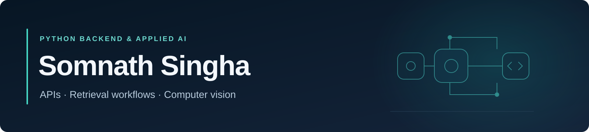

  

  <a href="#watchdesk">Featured work</a> &nbsp;·&nbsp;
  <a href="#public-code">Public code</a> &nbsp;·&nbsp;
  <a href="https://www.linkedin.com/in/amisomnath/">LinkedIn</a>

**I build Python backends that connect application data with practical AI features.**

I'm a Senior Software Engineer with 5+ years in software development. My work spans API and database design, retrieval workflows, asynchronous processing, testing and Linux/AWS deployment.

## WatchDesk

**Featured personal project · Computer vision + backend engineering**

An account-based laptop-monitoring system connecting a **native Python/OpenCV agent**, **FastAPI and Django REST services**, and a **Next.js portal**.

- **Owner-controlled workflows:** activation, consent-based enrollment, monitoring settings and warning review.
- **Engineering behind the workflow:** account isolation, camera-health telemetry, durable event queues and bounded local alerts.

[Explore the project overview →](projects/watchdesk.md) &nbsp;·&nbsp; Implementation maintained privately.

## Public code

| Project | What to explore |
| --- | --- |
| **[Hospital Management RAG](https://github.com/amisomnath/hospital-management-rag)** | **Backend + RAG teaching capstone.** FastAPI management APIs, JWT authentication, SQLAlchemy/Alembic, document ingestion, pgvector retrieval and REST/WebSocket chat. |
| **[Medical RAG Chatbot](https://github.com/amisomnath/medical-rag-chatbot)** | **Streaming document Q&A.** Local embeddings, persistent vector retrieval and Groq responses streamed through FastAPI WebSockets. Educational scope. |
| **[SocialHub](https://github.com/amisomnath/SocialHub)** | **REST API foundations.** Authentication, posts and tags, author checks, throttling, filtering, pagination and block-list management. |
| **[AcademicMinds](https://github.com/amisomnath/AcademicMinds)** | **Relational modeling.** Student, teacher and subject records, transactional enrollment and relationship queries through Django REST APIs. |

## How I work

**Design the backend.** Model data, define API boundaries and implement permission-aware workflows.  
**Connect the AI.** Build ingestion and retrieval pipelines, LangGraph workflows, structured outputs and evidence checks.  
**Support delivery.** Write pytest unit/API tests, handle background processing and troubleshoot deployments and integrations.

<strong>Tools I work with</strong>

| Area | Tools |
| --- | --- |
| Backend | Python, FastAPI, Django REST Framework, SQLAlchemy, PostgreSQL, MySQL, Celery, Redis |
| Applied AI | LLM APIs, LangChain, LangGraph, Sentence Transformers, pgvector, Qdrant, FAISS |
| Delivery | pytest, Git, Docker, AWS, Linux, NGINX |

## Beyond implementation

At Webskitters, I contribute to backend architecture and shared Python project templates. I also deliver Python/FastAPI internship training and support technical assessments, grading and developer feedback.

For engineering collaboration and technical mentoring, [connect with me on LinkedIn →](https://www.linkedin.com/in/amisomnath/).
